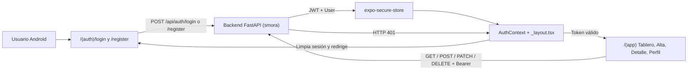

# Gestor de Tareas · App Móvil (Expo SDK 57 + React Native)

Aplicación móvil individual desarrollada con **React Native, Expo Router y TypeScript** para el **EDI — Desarrollo de Software Multiplataforma (2026)**. Permite registrar usuarios, iniciar sesión de forma segura con **JWT + `expo-secure-store`** y gestionar tareas personales conectadas a la API REST (`smora` en FastAPI + SQLAlchemy).

---

## 1. Objetivo del proyecto
Brindar una experiencia móvil clara, accesible y tolerante a fallos para administrar tareas personales (`pendiente` / `resuelta`), desacoplada del servidor mediante contratos REST tipados y preparada para compilar una **APK instalable en Android** con **EAS Build (`preview`)**.

## 2. Stack tecnológico
- **Frontend móvil:** React Native `0.86.3` · React `19.2.3` · Expo SDK `~57.0.0` · TypeScript `~5.9.2` (`strict`)
- **Navegación y rutas protegidas:** Expo Router `~57.0.29` (`typedRoutes`)
- **Almacenamiento seguro y sesión:** `expo-secure-store` `~57.0.4` + `AuthContext`
- **Red:** `fetch` nativo centralizado en [`src/services/apiClient.ts`](src/services/apiClient.ts) con `AbortController`, timeout y manejo de HTTP `401`
- **Testing:** Jest `^29.7.0` · `jest-expo` `~57.0.0` · `@testing-library/react-native` `^13.3.0`
- **Compilación Android:** EAS Build (`eas.json` perfil `preview` → `apk`)
- **Backend de referencia:** [`smora`](https://github.com/santiago99-mora/smora.git) (FastAPI + SQLAlchemy 2.0 + JWT + bcrypt)

---

## 3. Arquitectura y flujo de sesión



Más detalles técnicos y matriz de casos en [`docs/ARQUITECTURA_Y_PRUEBAS.md`](docs/ARQUITECTURA_Y_PRUEBAS.md) y el contrato completo en [`docs/CONTRATO_API.md`](docs/CONTRATO_API.md).

---

## 4. Estructura de carpetas

```text
app/
├── _layout.tsx              # AuthProvider + protección global de rutas
├── index.tsx                # Redirección inicial según sesión (/(auth)/login o /(app)/tasks)
├── guia.tsx                 # Guía de laboratorio y objetivos
├── (auth)/
│   ├── _layout.tsx
│   ├── login.tsx            # Pantalla 1 · Inicio de sesión (POST /api/auth/login)
│   └── register.tsx         # Pantalla 2 · Registro (POST /api/auth/register)
└── (app)/
    ├── _layout.tsx
    ├── tasks.tsx            # Pantalla 3 · Tablero, búsqueda, filtros y estados de red
    ├── new.tsx              # Pantalla 4 · Formulario de nueva tarea (POST /api/tasks)
    ├── profile.tsx          # Pantalla 6 · Perfil, URL/modo API, test 401 y logout
    └── task/[id].tsx        # Pantalla 5 · Detalle, edición (PUT), estado (PATCH) y borrado (DELETE)
assets/                      # icon.png, adaptive-icon.png y splash-icon.png
docs/                        # Ficha de interoperabilidad, arquitectura y pruebas
src/
├── components/              # TaskCard, StatusTabs, StateFeedback (con TSDoc y accesibilidad)
├── config/                  # Lectura de variables EXPO_PUBLIC_*
├── context/                 # AuthContext (restauración, signIn, signUp, signOut, 401)
├── services/                # apiClient, tokenStorage, authService, taskService, mockStore
├── theme/                   # Sistema de diseño centralizado (Obsidian & Volt Lime)
├── types/                   # Tipos TypeScript de Auth y Task
└── utils/                   # filterTasks, isValidTaskTitle, validateAuthForm
__tests__/                   # Suite Jest + RNTL (8 archivos, 26 tests)
```

---

## 5. Variables de entorno

Copiá `.env.example` a `.env` (`.env` está excluido en `.gitignore`):

```env
EXPO_PUBLIC_API_URL=https://smora.onrender.com
EXPO_PUBLIC_USE_MOCK=false
```

| Variable | Uso |
|---|---|
| `EXPO_PUBLIC_API_URL` | URL base del servidor FastAPI (`http://10.0.2.2:8000` en emulador Android, `http://TU_IP_LOCAL:8000` en Wi-Fi local, o URL `HTTPS` de Render para APK `preview`). |
| `EXPO_PUBLIC_USE_MOCK` | `"true"` activa el mock contractual local compatible 1:1 con `smora`; `"false"` consume el backend real. También puede alternarse desde Login o Perfil. |

---

## 6. Cómo levantar en local

### Requisitos
- Node.js **22.13 o superior**
- Backend `smora` ejecutándose en local (o URL HTTPS desplegada en Render)

### Instalación y ejecución
```bash
npm install
npx expo start --go
```
- Para development build: `npm start`
- Para emulador Android directo: `npm run android`

### Usuario de prueba del backend (`smora` con `SEED_DEMO_USER=true`)
- **Correo:** `demo@gestortareas.app`
- **Contraseña:** `Demo1234!`

---

## 7. Endpoints consumidos (`smora`)

| Método | Endpoint | Auth | Propósito |
|---|---|---|---|
| `POST` | `/api/auth/register` | No | Crea cuenta y devuelve JWT |
| `POST` | `/api/auth/login` | No | Autentica credenciales y devuelve JWT |
| `GET` | `/api/auth/me` | Bearer | Valida sesión restaurada |
| `GET` | `/api/tasks` | Bearer | Lista tareas del usuario autenticado |
| `POST` | `/api/tasks` | Bearer | Crea una nueva tarea |
| `GET` | `/api/tasks/:id` | Bearer | Obtiene detalle de una tarea |
| `PUT` | `/api/tasks/:id` | Bearer | Actualiza título, descripción, prioridad y estado |
| `PATCH` | `/api/tasks/:id/status` | Bearer | Alterna estado (`pendiente` / `resuelta`) |
| `DELETE` | `/api/tasks/:id` | Bearer | Elimina la tarea (`204 No Content`) |

---

## 8. Scripts, pruebas y build APK (`preview`)

```bash
npm run typecheck    # Verificación estricta de TypeScript (tsc --noEmit)
npm test             # Ejecuta Jest + React Native Testing Library (8 suites, 26 tests)
npm run doctor       # Diagnóstico de compatibilidad Expo SDK 57
```

### Generar APK instalable en perfil `preview` (EAS Build)
1. Verificar que `EXPO_PUBLIC_API_URL` en `eas.json` (`build.preview.env`) apunte a la URL HTTPS real del backend.
2. Iniciar sesión en Expo y compilar:
```bash
eas login
eas build --platform android --profile preview
```

---

## 9. Documentación adicional del taller
- Informe de incidencias de debugging y testing: [`INFORME_INCIDENTES.md`](INFORME_INCIDENTES.md)
- Guía original del laboratorio: [`GUIA_ESTUDIANTES.md`](GUIA_ESTUDIANTES.md)
